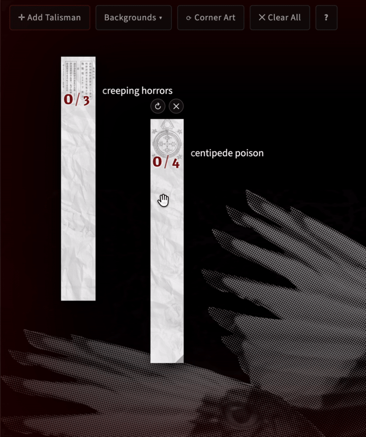

# CAIN — Talisman Board

A drag-and-drop virtual talisman board for [CAIN](https://tombloom.itch.io/cain), Tom Bloom's tabletop RPG of exorcists hunting sins. Pin talismans over a moody backdrop, carve slashes as the hunt escalates, and let the board keep score between sessions.

## Running it

A hosted copy runs at [cora.earth/games/cain/talismans](https://cora.earth/games/cain/talismans/) if you'd rather skip the setup entirely.

To run it yourself: the board is a single HTML file plus art folders — no build step, nothing to install except Python (any recent version; it's only used for its built-in web server).

- **macOS** — double-click `open-talismans.command`. If Gatekeeper objects the first time, right-click it and choose *Open* (or run `bash open-talismans.command` from Terminal).
- **Windows** — double-click `open-talismans.bat`. If a Microsoft Store window opens instead of the board, install Python from [python.org](https://www.python.org/downloads/) and re-run it.
- **Anywhere** — from this folder, run `python3 make-manifest.py --serve 8137`, then open <http://localhost:8137/talismans.html>.

Either launcher opens the board in your browser and keeps a small local server running — leave its window open while you play, close it (or press Ctrl-C) when you're done.

You can also open `talismans.html` straight from the file system, without any server. Everything works except picking up new art files (see below) — the board falls back to its built-in art list.

## Using the board

- **✛ Add Talisman** deals a talisman onto the board; **drag** it to move it.
- **Click** a talisman to carve a slash; **right-click** removes one.
- The counter under each talisman tracks **slashes / N** — click the **N** to set a target, click beside it to add a text label.
- **Ctrl/⌘ + scroll** over a talisman, or drag its **◢ corner**, to resize. Hover one for swap-art and delete buttons.
- **Backgrounds ▾** sets the backdrop — fill/fit modes, a dimmer, and uploading your own image.
- **⟳ Corner Art** shuffles the decorative detail in the corner.
- The board autosaves to your browser's localStorage, so your hunt is still there when you come back.

## Adding your own art

Drop images into these folders and refresh the page:

- `reference/talismans/` — talisman paper strips (tall and narrow)
- `reference/backgrounds/` — full-screen backdrops
- `reference/details/` — corner decoration art

The board finds the art through `reference/manifest.json`, a list of the image files in each folder. The launchers' server rewrites it every time the page loads, so new images show up on a refresh. Served any other way (another static file server, or the hosted copy), run `python3 make-manifest.py` after adding or removing art so the manifest matches the folders, and commit it along with the images; `python3 make-manifest.py --check` says whether it's up to date.

## Credits

CAIN is by [Tom Bloom](https://tombloom.itch.io/cain). The art on this board comes from the CAIN books — original work alongside collage, background, and texture pieces built from public-use photos sourced from Wikimedia Commons — and is included here with Tom Bloom's kind permission. This is an unofficial, fan-made play aid, not affiliated with or endorsed by him. If it sees use at your table, go buy CAIN.

## Exorcist sheet

`exorcist-sheet/` is a separate, self-contained character sheet (open its `index.html`; it autosaves to localStorage too). A hosted copy runs at [cora.earth/games/cain/exorcist-sheet](https://cora.earth/games/cain/exorcist-sheet/).

## License

The code (`talismans.html`, the launchers, and the exorcist sheet's HTML/JS/CSS) is under the [MIT License](LICENSE). The images — everything under `reference/` and `exorcist-sheet/assets/art/`, plus the demo GIF — are **not** covered by it: that art belongs to Tom Bloom and appears here with his permission, so don't redistribute it outside this play aid.
